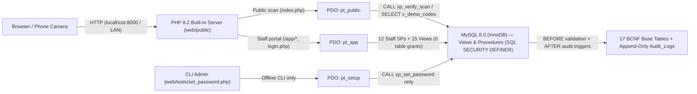
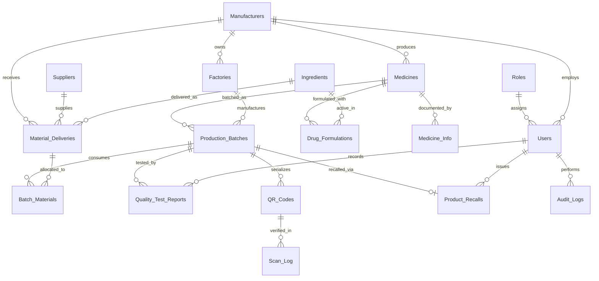

# PharmaTrace 360 — A-to-Z DBMS Project Overview

> **Project:** PharmaTrace 360 — Smart Pharmaceutical Manufacturing, Quality Assurance & Drug Authentication System  
> **Course:** 2nd-Year B.Tech DBMS Project  
> **Database Engine:** MySQL 8.0+ (InnoDB, `utf8mb4` / `utf8mb4_unicode_ci`)  
> **Application Stack:** PHP 8.2+ (PDO Prepared Statements) + HTML/CSS/Bootstrap/JS + Python 3 (data & seed pipeline)

---

## 1. Executive Summary & System Lifecycle

**PharmaTrace 360** solves pharmaceutical counterfeiting, quality-control bypass, and slow recall tracing using a single normalized relational database that tracks every medicine pack across its complete lifecycle:

```
Raw Material Delivery (Supplier + CoA)
        │
        ▼
Production Batch (Pending)  ──►  Raw Material Linkage (Batch_Materials)
        │
        ▼
Quality Assurance Testing (Pass / Fail)
        │
        ├── Fail ──► Rejected (no QR codes allowed)
        │
        └── Pass ──► Approved ──► Serialized QR Code Issuance (1 code per pack)
                                          │
                                          ▼
                               Public Anonymous Scan (sp_verify_scan)
                                 • Genuine / Expired / Recalled / Not approved / Suspicious
                                          │
                                          ▼
                               Regulatory Recall (sp_issue_recall) & Immutable Audit Trail
```

### Database Inventory at a Glance

| DBMS Object | Count | Source File(s) |
|---|---:|---|
| Base Tables (BCNF) | **17** | `db/01_schema.sql` |
| Foreign Keys | **21** | `db/01_schema.sql` |
| `CHECK` Constraints | **7** | `db/01_schema.sql` |
| Named Indexes & `UNIQUE` Keys | **18** | `db/01_schema.sql`, `db/06_suspicious_review.sql`, `db/09_upgrade_existing.sql` |
| Views | **16** | `db/03_logic.sql`, `db/06_suspicious_review.sql` |
| Stored Functions | **3** | `db/03_logic.sql` |
| Stored Procedures | **14** | `db/03_logic.sql`, `db/06_suspicious_review.sql` |
| Triggers (`BEFORE` + `AFTER`) | **16** | `db/03_logic.sql` |
| Least-Privilege MySQL Accounts | **3** | `pt_public`, `pt_app` (`db/05_grants.sql`), `pt_setup` (`db/10_setup_grants.sql`) |
| Seeded Demo Rows | **390** | `db/02_seed.sql` (generated by `db/build_seed.py`) |

---

## 2. Technology Stack, Languages, MySQL Internals & Project Structure

### Languages & Technologies Used (and Why)

| Layer | Language / Tool | Exact Role in PharmaTrace 360 |
|---|---|---|
| **Database & Business Logic** | **SQL (MySQL 8.0+)** | Core relational database: 17 BCNF tables, foreign keys, `CHECK`/`UNIQUE` constraints, 18 indexes, 16 views, 3 functions, 16 triggers, 14 stored procedures, transactions (`FOR UPDATE`), and least-privilege `GRANT`s. |
| **Backend Server** | **PHP 8.2+** (`declare(strict_types=1)`) | Lightweight server-rendered backend run via PHP's built-in server (`php -S localhost:8000 -t web/public`). Connects to MySQL exclusively through **PDO (`pdo_mysql`)** with native prepared statements (`PDO::ATTR_EMULATE_PREPARES => false`). |
| **Frontend Markup & Styling** | **HTML5, CSS3, Bootstrap 5.3** | Semantic, WCAG AA accessible consumer & staff interfaces (`web/public/assets/style.css` + vendored local `bootstrap.min.css` & `bootstrap.bundle.min.js`, zero CDN dependency for Bootstrap). |
| **Client-Side Scripting** | **Vanilla JavaScript (ES6) + `qrcodejs`** | Renders scannable unit-level QR codes in the browser (`web/public/assets/vendor/qrcode/qrcode.min.js`), powers printable 4-column A4 QR sheets (`qr_sheet.php`), and handles `DEMO_MODE` quick-fill interactions. |
| **Data Cleaning & Seed Generation** | **Python 3** (standard library: `csv`, `re`, `uuid`, `pathlib`) | Offline data pipeline (`data/clean/build_medicines_15.py` cleans raw Kaggle CSVs into `medicines_15.csv`; `db/build_seed.py` deterministically generates `db/02_seed.sql`). Not required at runtime. |
| **Documentation & Diagrams** | **Markdown + Mermaid** | All academic & technical docs in `docs/`, including the full 17-table Mermaid ER diagram (`docs/er_diagram.md`). |
| **CI / Automated Verification** | **GitHub Actions (YAML)** | `.github/workflows/ci.yml` automatically lints PHP 8.2, compiles Python 3.12, boots a real **MySQL 8.0** container, and tests every SQL bootstrap, query, ACID demo, upgrade, and regression script on every push. |

### MySQL 8.0 Engine & Configuration Details

| Setting / Feature | Value / Implementation | Why It Matters (Viva Explanation) |
|---|---|---|
| **DBMS** | MySQL Community Server **8.0+** (`MySQL80` Windows service, TCP port `3306`) | Supports native enforced `CHECK` constraints (ignored before MySQL 8.0.16), Window Functions (`ROW_NUMBER`, `RANK`, `SUM OVER`), CTEs (`WITH`), and `SIGNAL SQLSTATE`. |
| **Storage Engine** | **InnoDB** (default for all 17 tables) | Required for full **ACID** transactions, foreign key enforcement, row-level locking (`SELECT ... FOR UPDATE`), and crash-safe Write-Ahead Logging (redo log). |
| **Character Set & Collation** | `utf8mb4` / `utf8mb4_unicode_ci` | Full Unicode safety; case-insensitive matching lets consumers manually type `pt360-...` in lowercase while `uq_qr_code` still prevents mixed-case duplicates. |
| **Default Isolation Level** | `REPEATABLE-READ` | Prevents dirty reads and non-repeatable reads; paired with `FOR UPDATE` row locks on `Production_Batches` and `Material_Deliveries` to eliminate lost updates & TOCTOU races. |
| **Durability Setting** | `innodb_flush_log_at_trx_commit = 1` | Flushes the redo log to disk on every `COMMIT` so committed data survives sudden crashes. |
| **PHP Driver** | `PDO` (`pdo_mysql`) with `ERRMODE_EXCEPTION` & `EMULATE_PREPARES = false` | Forces real server-side parameterized queries, eliminating SQL injection and properly reading multi-result sets from `sp_verify_scan` via `nextRowset()` / `closeCursor()`. |

### End-to-End Request Architecture



### Complete Project Folder & File Map

```text
PharmaTrace360/
├── README.md                          # Project introduction & quick start
├── COMMANDS.md                        # Copy-paste MySQL, PHP & maintenance command cookbook
├── .github/workflows/ci.yml           # Automated PHP/Python lint + MySQL 8.0 CI verification
├── data/
│   ├── raw/                           # Read-only Kaggle CSVs (gitignored, never modified)
│   └── clean/
│       ├── build_medicines_15.py      # Extracts & normalizes 15 real medicines from raw CSVs
│       └── medicines_15.csv           # Clean 15-medicine dataset imported by db/build_seed.py
├── db/
│   ├── 00_reset_all.sql               # Master fresh install (01 -> 02 -> 03 -> 06_review -> 05)
│   ├── 01_schema.sql                  # 17 BCNF tables, 21 FKs, 7 CHECKs, 18 indexes/UKs
│   ├── 02_seed.sql                    # 390 rows across 17 tables (generated by build_seed.py)
│   ├── 03_logic.sql                   # 16 views, 3 functions, 16 triggers, 13 stored procedures
│   ├── 04_demo.sql                    # End-to-end SQL walkthrough (views, scan, approve, recall, EXPLAIN)
│   ├── 05_grants.sql                  # Least-privilege GRANTs for pt_public & pt_app
│   ├── 06_queries.sql                 # 14 labelled read-only SQL queries (JOINs, CTE, Window, Trace)
│   ├── 06_suspicious_review.sql       # Repeatable migration: Scan_Log.review_status + sp_update_suspicious_review
│   ├── 07_acid_demo.sql               # Runnable Atomicity, Consistency, Isolation & Durability demo
│   ├── 08_feature_tests.sql           # Happy-path & negative trigger/procedure regression suite
│   ├── 09_upgrade_existing.sql        # Non-destructive schema/index/routine upgrade for existing DBs
│   ├── 10_setup_grants.sql            # CLI-only sp_set_password grant for pt_setup
│   └── build_seed.py                  # Python script that builds db/02_seed.sql
├── web/
│   ├── config.sample.php              # Template config (copy to gitignored web/config.local.php)
│   ├── includes/
│   │   ├── db.php                     # PDO pools (dbPublic/dbApp/dbSetup), session/CSRF, security headers
│   │   └── layout.php                 # Shared staff header, role-aware nav, Bootstrap JS footer
│   ├── tools/set_password.php         # CLI-only bcrypt password bootstrapper (uses pt_setup)
│   └── public/
│       ├── index.php                  # Anonymous public QR verification portal
│       ├── login.php / logout.php     # Staff auth (with DEMO_MODE quick-fill) & POST CSRF logout
│       ├── assets/                    # style.css + vendored Bootstrap 5.3 & qrcode.min.js
│       └── app/                       # Role-guarded staff pages: dashboard, batches, all_batches,
│                                      # batch_new, batch_detail, deliveries, qr_sheet, recall,
│                                      # recalls, suspicious, audit, change_password
└── docs/
    ├── DBMS_A_TO_Z_OVERVIEW.md        # This complete A-to-Z DBMS & architecture guide
    ├── er_diagram.md                  # Full 17-table Mermaid ER diagram + relationship guide
    ├── relational_schema.md           # Relational schema notation (PK/FK summary)
    ├── data_dictionary.md             # Column-by-column data dictionary
    ├── normalization.md               # Plain-English 1NF -> 2NF -> 3NF -> BCNF proof
    ├── functional_dependencies.md     # Formal candidate keys, FDs & deliberate denormalisations
    ├── logic_overview.md              # Detailed breakdown of views, functions, triggers & procedures
    ├── dbms_audit.md                  # Formal DBMS audit report & resolutions
    ├── expected_counts.md             # Exact expected row counts (390 rows) & demo scenarios
    ├── test_cases.md                  # Functional & security test matrix
    ├── SETUP.md                       # Step-by-step Windows MySQL 8 + PHP setup guide
    ├── CONTEXT.md                     # Single source of truth for project rules & scope
    ├── data_overrides.md              # Documented hand-supplied values & rationale
    ├── dataset_report.md              # Raw Kaggle dataset exploration & cleaning report
    ├── known_limitations.md           # Transparent academic assumptions & trade-offs
    ├── audit_fixes.md                 # Security/DB audit fix log
    └── changes_from_original_plan.md  # Evolution notes from initial plan
```

---

## 3. Schema Architecture & ER Design (All 17 Tables)

The schema is organized into **four clean relational domains**:

### A. Identity & Access Domain (2 tables)
1. **`Roles`** (`role_id` PK, `role_name` UNIQUE) — Contains exactly **2 rows**: `Admin/Regulator` and `Manufacturer`. Public visitors never log in and have no row here.
2. **`Users`** (`user_id` PK, `full_name`, `email` UNIQUE, `password_hash`, `role_id` FK, `manufacturer_id` FK nullable, `is_active`, `created_at`) — Stores staff accounts with bcrypt hashes. Triggers enforce `manufacturer_id IS NULL` for Admins and `IS NOT NULL` for Manufacturers.

### B. Master Organization & Drug Catalog Domain (6 tables)
3. **`Manufacturers`** (`manufacturer_id` PK, `company_name`, `registration_no` UNIQUE, contact details) — Pharmaceutical companies (9 real manufacturers from Kaggle data).
4. **`Factories`** (`factory_id` PK, `manufacturer_id` FK, `factory_name`, `location`, `license_no`) — Licensed plants owned by manufacturers (18 plants).
5. **`Suppliers`** (`supplier_id` PK, `supplier_name` UNIQUE, contact details) — Vetted external chemical/API vendors (database records, not login accounts).
6. **`Ingredients`** (`ingredient_id` PK, `ingredient_name` UNIQUE, `cas_number`) — Active pharmaceutical ingredients (15 ingredients).
7. **`Medicines`** (`medicine_id` PK, `brand_name`, `manufacturer_id` FK, `dosage_form`, `pack_size`, `therapeutic_class`, `habit_forming`, `storage_note`, `source_note`; UNIQUE `(brand_name, manufacturer_id)`).
8. **`Drug_Formulations`** — **Many-to-Many junction table** (`(medicine_id, ingredient_id)` composite PK, `strength`, `is_active`). Maps medicines to active ingredients and strengths.
9. **`Medicine_Info`** (`info_id` PK, `medicine_id` FK, `info_type` ENUM `'use','side_effect','avoid_with'`, `info_text`; UNIQUE `(medicine_id, info_type, info_text(200))`). Normalizes repeating consumer safety lists into atomic 1NF rows.

### C. Supply Chain, Manufacturing & QA Domain (4 tables)
10. **`Material_Deliveries`** (`delivery_id` PK, `supplier_id` FK, `ingredient_id` FK, `manufacturer_id` FK, `quantity_kg > 0`, `received_date`, `certificate_number` UNIQUE) — Inbound API shipments with Certificate of Analysis (CoA).
11. **`Production_Batches`** (`batch_id` PK, `batch_number` UNIQUE, `medicine_id` FK, `factory_id` FK, `quantity_units > 0`, `manufacture_date`, `expiry_date > manufacture_date`, `status` ENUM `'Pending','Approved','Rejected','Recalled'`).
12. **`Batch_Materials`** — **Many-to-Many junction table** (`(batch_id, delivery_id)` composite PK, `quantity_used_kg > 0`). Connects each batch to the exact upstream raw-material deliveries consumed.
13. **`Quality_Test_Reports`** (`report_id` PK, `batch_id` FK, `tested_by` FK, `test_date`, `purity_pct`, `dissolution_pct`, `weight_variation_pct`, `result` ENUM `'Pass','Fail'`, `remarks`) — Supports multiple re-tests per batch.

### D. Serialization, Verification, Recall & Audit Domain (4 tables)
14. **`QR_Codes`** (`qr_id` PK, `code` UNIQUE, `batch_id` FK, `issued_at`) — One unique code per physical pack (`1-to-many` from batch). Issued only when batch status is `Approved`.
15. **`Scan_Log`** (`scan_id` PK, `scanned_code` VARCHAR(64), `qr_id` nullable FK, `scanned_at`, `verdict` ENUM, `review_status` ENUM `'New','Reviewed','Blocked'`) — Stores every scan attempt, including unknown/counterfeit strings (`qr_id = NULL`).
16. **`Product_Recalls`** (`recall_id` PK, `batch_id` UNIQUE FK, `reason`, `recall_date`, `issued_at`, `issued_by` FK) — `1-to-1` with `Production_Batches` (a batch can be recalled at most once).
17. **`Audit_Logs`** (`log_id` BIGINT PK, `user_id` nullable FK, `action`, `table_name`, `record_id`, `details`, `logged_at`) — Append-only forensic history enforced by `BEFORE UPDATE`/`BEFORE DELETE` triggers.

### High-Level ER Diagram



### Relationship Breakdown
- **1-to-Many (16 relationships):** e.g., `Roles → Users`, `Manufacturers → Factories`, `Production_Batches → QR_Codes`, `Production_Batches → Quality_Test_Reports`, `QR_Codes → Scan_Log`.
- **Many-to-Many (2 relationships):** `Medicines ↔ Ingredients` via `Drug_Formulations`; `Production_Batches ↔ Material_Deliveries` via `Batch_Materials`.
- **1-to-1 (1 relationship):** `Production_Batches ↔ Product_Recalls` via `UNIQUE (batch_id)`.

### Key Schema Design Decisions
- **Why is `Scan_Log.scanned_code` NOT a foreign key?** Counterfeiters print fake QR strings that do not exist in `QR_Codes`. Making `scanned_code` a plain `VARCHAR(64)` and `qr_id` a *nullable* FK lets the database log unknown counterfeit attempts while preserving referential integrity for valid codes.
- **Why is `Audit_Logs.user_id` nullable?** System/trigger events without a web session user still get logged cleanly without breaking FK constraints.

---

## 4. Keys, Constraints & Referential Integrity

### `CHECK` Constraints (7 total — single-row domain integrity)
| Table | Constraint | Rule |
|---|---|---|
| `Material_Deliveries` | `chk_delivery_qty` | `quantity_kg > 0` |
| `Production_Batches` | `chk_batch_qty` | `quantity_units > 0` |
| `Production_Batches` | `chk_batch_dates` | `expiry_date > manufacture_date` |
| `Batch_Materials` | `chk_bm_qty` | `quantity_used_kg > 0` |
| `Quality_Test_Reports` | `chk_purity` | `purity_pct IS NULL OR purity_pct BETWEEN 0 AND 100` |
| `Quality_Test_Reports` | `chk_dissolution` | `dissolution_pct IS NULL OR dissolution_pct BETWEEN 0 AND 100` |
| `Quality_Test_Reports` | `chk_weight_var` | `weight_variation_pct IS NULL OR weight_variation_pct BETWEEN 0 AND 100` |

### `ON DELETE` Referential Actions (21 Foreign Keys)
- **`ON DELETE RESTRICT` (18 FKs):** Protects all operational, financial, QA, traceability, recall, QR, and audit records (`Batch_Materials`, `Quality_Test_Reports`, `QR_Codes`, `Product_Recalls`, `Audit_Logs`, `Production_Batches`, `Material_Deliveries`, `Users`, `Factories`, `Medicines`). Users are deactivated (`is_active = 0`), never deleted.
- **`ON DELETE CASCADE` (2 FKs — master catalog child rows only):** `Drug_Formulations.medicine_id` and `Medicine_Info.medicine_id` (descriptive child attributes of a medicine).
- **`ON DELETE SET NULL` (1 FK):** `Scan_Log.qr_id` — preserves historical scan logs even if a QR record were ever archived.
- **All 21 FKs use `ON UPDATE CASCADE`** for safe key propagation.

---

## 5. Normalization (1NF → BCNF) & Deliberate Denormalisations

| Normal Form | Rule | How PharmaTrace 360 Satisfies It |
|---|---|---|
| **1NF** | Atomic values, no repeating groups | Raw Kaggle CSV stored semicolon-separated `uses`, `side_effects`, `when_to_avoid` and numbered `active_ingredient_1/2` columns. Splitting into `Medicine_Info` and `Drug_Formulations` makes every cell atomic. |
| **2NF** | No partial dependency on a composite PK | Both composite-PK junction tables (`Drug_Formulations(medicine_id, ingredient_id)` and `Batch_Materials(batch_id, delivery_id)`) store only attributes (`strength`, `is_active`, `quantity_used_kg`) that depend on the **entire** composite key. |
| **3NF** | No transitive dependencies | `Medicines` stores `manufacturer_id` (not company name/address); `Production_Batches` stores `factory_id` (not factory location/license); `Material_Deliveries` stores `supplier_id` & `ingredient_id`. |
| **BCNF** | Every determinant is a candidate key | Every table's non-trivial functional dependencies have a superkey on the left-hand side (`role_id`/`role_name`, `manufacturer_id`/`registration_no`, `user_id`/`email`, `batch_id`/`batch_number`, `qr_id`/`code`, `recall_id`/`batch_id`, etc.). |

### Deliberate Denormalisations (Important for Viva!)
1. **`Scan_Log.verdict` (Point-in-Time Snapshot):** Stores what the system told the consumer *at the moment of scanning* (e.g. `Genuine` in June before a September recall). This cannot be recomputed from current batch status — storing the snapshot is mandatory for regulatory forensics.
2. **`ENUM` Columns (`status`, `result`, `verdict`, `info_type`, `review_status`):** Closed, stable domains encoded directly in MySQL `ENUM` for fast checks without extra lookup joins.
3. **Dual Path to `manufacturer_id` on `Production_Batches`:** Reachable via both `medicine_id → Medicines.manufacturer_id` and `factory_id → Factories.manufacturer_id`. Not duplicate storage — cross-path agreement is strictly enforced by triggers `trg_batches_bi` and `trg_batches_bu`.

---

## 6. Indexing Strategy & `EXPLAIN` Proofs

Every secondary index exists to serve a concrete query path:

| Table | Index / Unique Key | Columns | Queries Optimized |
|---|---|---|---|
| `Roles` | `uq_roles_name` | `(role_name)` | Role lookups in triggers & procedures |
| `Manufacturers` | `uq_mfr_reg` | `(registration_no)` | Corporate registration uniqueness |
| `Users` | `uq_users_email` | `(email)` | `sp_login_lookup` authentication |
| `Suppliers` | `uq_supplier_name` | `(supplier_name)` | `sp_record_delivery` lookup & uniqueness |
| `Ingredients` | `uq_ingredient_name` | `(ingredient_name)` | `sp_record_delivery` lookup & uniqueness |
| `Material_Deliveries` | `uq_delivery_certificate` | `(certificate_number)` | `sp_add_batch_material` CoA lookup & `FOR UPDATE` locking |
| `Medicines` | `uq_medicine_brand` | `(brand_name, manufacturer_id)` | `sp_create_batch` ownership check & uniqueness |
| `Medicine_Info` | `uq_medicine_info_item` | `(medicine_id, info_type, info_text(200))` | Duplicate prevention + 3× `sp_verify_scan` info lookups |
| `Production_Batches` | `uq_batch_number` | `(batch_number)` | All batch procedures & detail pages |
| `Production_Batches` | `idx_batches_status_expiry` | `(status, expiry_date)` | `v_dashboard`, `v_batch_status_counts`, `v_demo_codes`, Q10–Q12 |
| `Quality_Test_Reports` | `idx_qtr_batch_latest` | `(batch_id, test_date, report_id)` | Latest-test lookup (`ORDER BY test_date DESC, report_id DESC LIMIT 1`) in `trg_batches_bu` & `sp_reject_batch` |
| `QR_Codes` | `uq_qr_code` | `(code)` | Primary public scan lookup (`const` access in `EXPLAIN`) |
| `Scan_Log` | `idx_scan_code_time` | `(scanned_code, scanned_at)` | Rolling 48-hour velocity check (`fn_recent_scan_count`) & leftmost-prefix lookup by `scanned_code` |
| `Scan_Log` | `idx_scan_at` | `(scanned_at)` | Time-window scans in `v_suspicious_codes` |
| `Scan_Log` | `idx_scan_verdict` | `(verdict)` | Index-only count for `v_dashboard.suspicious_scans` |
| `Scan_Log` | `idx_scan_review_status` | `(review_status)` | Analyst triage filtering (`06_suspicious_review.sql`) |
| `Product_Recalls` | `uq_recall_batch` | `(batch_id)` | Enforces 1-to-1 recall per batch & speeds recall joins |
| `Audit_Logs` | `idx_audit_logged_at` / `idx_audit_table_record` | `(logged_at)` / `(table_name, record_id, action)` | `v_recent_audit` (top 20) and `v_batch_timeline` joins |

### Live `EXPLAIN` Commands for Presentation
```sql
EXPLAIN SELECT * FROM QR_Codes WHERE code = 'PT360-20515ECBE7F2';
-- Uses uq_qr_code (type: const, rows: 1)

EXPLAIN SELECT * FROM Scan_Log WHERE scanned_code = 'PT360-2DBC2CDE0F05';
-- Uses idx_scan_code_time (leftmost prefix rule)
```

---

## 7. Views Catalog (All 16 Views)

Views decouple the PHP application from raw tables and enforce least-privilege access (`pt_public` and `pt_app` read *only* views).

| View | Purpose | Key DBMS Concepts |
|---|---|---|
| `v_demo_codes` | Returns 1 sample code each for `Genuine` (excluding codes with > 10 scans in 48h), `Expired`, and `Recalled` | `UNION ALL`, correlated count guard, `LIMIT 1` |
| `v_batch_overview` | One row per batch with medicine, manufacturer, factory, status, and QR count | 4-table `JOIN` + `LEFT JOIN` + `GROUP BY` + `COUNT` |
| `v_batch_traceability` | Upstream raw material, supplier, delivery date, quantity used, and CoA per batch | 6-table `JOIN` across `Batch_Materials` M:N bridge |
| `v_batch_tests` | QA assay history per batch | `INNER JOIN` projection |
| `v_batch_qr_codes` | Serialized QR codes per batch with total scans & last scan timestamp | `LEFT JOIN` + `GROUP BY` + `COUNT`/`MAX` |
| `v_batch_timeline` | Unified chronological lifecycle history (manufactured, delivery received, material linked, QA test, QR issued, status change, recall) | 7-way `UNION ALL` across base tables & `Audit_Logs` |
| `v_my_deliveries` | Live delivery balance (`quantity_kg`, `used_kg`, computed `remaining_kg`) per manufacturer | `LEFT JOIN` + `GROUP BY` + `COALESCE(SUM)` |
| `v_form_suppliers` | Sorted supplier list for UI dropdowns | View encapsulation |
| `v_form_ingredients` | Sorted ingredient list for UI dropdowns | View encapsulation |
| `v_form_medicines` | Branded medicines filtered by `manufacturer_id` | Multi-tenant view |
| `v_form_factories` | Licensed plants filtered by `manufacturer_id` | Multi-tenant view |
| `v_dashboard` | Single-row executive KPI summary (`approved_batches`, `failed_tests`, `suspicious_scans`, `recalls`) | 4 scalar subqueries in `SELECT` |
| `v_batch_status_counts` | Batch count grouped by status (`Pending`, `Approved`, `Rejected`, `Recalled`) | `GROUP BY` + `COUNT` |
| `v_suspicious_codes` | Flags codes scanned **> 10 times in the rolling 48-hour window** with persisted analyst `review_status` (`New`/`Reviewed`/`Blocked`) | Time-window filter, `GROUP BY` + `HAVING`, correlated latest-decision subquery |
| `v_recent_audit` | 20 most recent immutable audit events with user display names | `LEFT JOIN` + `ORDER BY DESC LIMIT 20` |
| `v_recall_list` | Regulatory recall monitor with QR counts, total scans, and post-recall scans (`scanned_at >= pr.issued_at`) | Multi-table `JOIN` + correlated subqueries |

---

## 8. Stored Functions (All 3 Functions)

All functions are declared `READS SQL DATA` and `NOT DETERMINISTIC` (they query live table state and `NOW()`/`CURDATE()`).

1. **`fn_recent_scan_count(p_code, p_hours)`** — Counts `Scan_Log` rows for `p_code` where `scanned_at >= NOW() - INTERVAL p_hours HOUR`.
2. **`fn_qr_verdict(p_code)`** — Evaluates a scanned code in strict priority order (first match wins):
   1. Not in `QR_Codes` → **`Suspicious`**
   2. Batch status = `'Recalled'` → **`Recalled`**
   3. Batch status != `'Approved'` → **`Not approved`**
   4. `expiry_date < CURDATE()` → **`Expired`**
   5. `fn_recent_scan_count(p_code, 48) > 10` → **`Suspicious`**
   6. Otherwise → **`Genuine`**
3. **`fn_user_can_manage_batch(p_user_id, p_batch_number)`** — Returns `1` iff the user is active (`is_active = 1`), has role `Manufacturer`, and owns the batch's factory (`Users.manufacturer_id = Factories.manufacturer_id`); otherwise `0`.

---

## 9. Triggers (All 16 Triggers)

Triggers enforce **cross-table, state-machine, and immutability rules** that plain `CHECK` constraints cannot express.

### Validation (`BEFORE`) Triggers — 10 Triggers
| Trigger | Table & Event | Business Rule Enforced (`SIGNAL SQLSTATE '45000'`) |
|---|---|---|
| `trg_users_bi` / `trg_users_bu` | `Users` BEFORE INSERT / UPDATE | `Manufacturer` must have `manufacturer_id`; `Admin/Regulator` must have `manufacturer_id IS NULL`. |
| `trg_batches_bi` | `Production_Batches` BEFORE INSERT | Batch's `medicine_id` and `factory_id` must belong to the same manufacturer. |
| `trg_batches_bu` | `Production_Batches` BEFORE UPDATE | Same-manufacturer check; `Recalled` batches are immutable; `Approved`/`Rejected` allowed only from `Pending`; `Approved` requires latest QA test = `'Pass'` AND ≥ 1 linked material; `Rejected` requires latest QA test = `'Fail'`; `Recalled` requires an existing `Product_Recalls` row. |
| `trg_batch_materials_bi` | `Batch_Materials` BEFORE INSERT | Batch must be `Pending`; delivery must belong to batch's manufacturer; delivery ingredient must exist in the medicine's `Drug_Formulations`; `received_date <= manufacture_date`; cumulative `SUM(quantity_used_kg) + NEW <= quantity_kg`. |
| `trg_batch_materials_bu` / `trg_batch_materials_bd` | `Batch_Materials` BEFORE UPDATE / DELETE | Blocks modifying or deleting linked materials once a batch leaves `Pending`. |
| `trg_qr_codes_bi` | `QR_Codes` BEFORE INSERT | Serialized QR codes can only be inserted for `Approved` batches. |
| `trg_audit_logs_bu` / `trg_audit_logs_bd` | `Audit_Logs` BEFORE UPDATE / DELETE | Unconditionally raises `'Audit log is append-only.'`. |

### Automatic Audit (`AFTER`) Triggers — 6 Triggers
Every operational table automatically writes to `Audit_Logs` using the session variable `@app_user_id` set by procedures:
- `trg_deliveries_ai` → `DELIVERY_RECORDED`
- `trg_batches_ai` → `BATCH_CREATED`
- `trg_batches_au` → `STATUS_<NEW_STATUS>` (e.g., `STATUS_APPROVED`, `STATUS_RECALLED`)
- `trg_batch_materials_ai` → `MATERIAL_LINKED`
- `trg_qtr_ai` → `INSERT_QA_TEST`
- `trg_recalls_ai` → `INSERT_RECALL`

> **Why audit in triggers rather than PHP?** Even direct SQL changes in the MySQL CLI are automatically captured in `Audit_Logs`.

---

## 10. Stored Procedures (All 14 Procedures)

| Category | Procedure | What It Does |
|---|---|---|
| **Public** | `sp_verify_scan(p_code)` | Evaluates `fn_qr_verdict`, inserts into `Scan_Log`, and returns up to **4 result sets** (main drug sheet + `scan_count`, uses, side effects, drug interactions) while redacting suppliers, QA values, and costs. Unknown codes return verdict + advisory only. |
| **Manufacturer** | `sp_record_delivery(...)` | Validates active Manufacturer, quantity > 0, `received_date <= CURDATE()`, unique CoA, inserts into `Material_Deliveries` in a transaction. |
| **Manufacturer** | `sp_create_batch(...)` | Validates active Manufacturer + medicine/factory ownership + dates, creates `Pending` batch in a transaction. |
| **Manufacturer** | `sp_add_batch_material(...)` | Locks batch row **and** delivery row (`FOR UPDATE`), verifies ownership & `Pending` status, inserts into `Batch_Materials` (trigger checks stock & dates). |
| **Manufacturer** | `sp_record_test(...)` | Locks batch `FOR UPDATE`, verifies ownership & `Pending` status, validates 0–100% assay metrics, inserts `Quality_Test_Reports`. |
| **Manufacturer** | `sp_approve_batch(...)` | Locks batch `FOR UPDATE`, verifies ownership, sets `status = 'Approved'` (trigger validates Pass test + linked materials), and atomically generates `1–50` unique `PT360-...` QR codes in a `WHILE` loop. |
| **Manufacturer** | `sp_reject_batch(...)` | Locks batch `FOR UPDATE`, verifies ownership, `Pending` status, and latest test = `'Fail'`, transitions batch to `'Rejected'`. |
| **Admin** | `sp_issue_recall(...)` | Verifies active `Admin/Regulator`, locks batch `FOR UPDATE`, inserts `Product_Recalls` (with `issued_at = NOW()`), sets `status = 'Recalled'`, and returns the **impact assessment report** (supplier, CoA, QR count, prior scans). |
| **Admin** | `sp_update_suspicious_review(...)` | Verifies active `Admin/Regulator`, updates `Scan_Log.review_status` (`New`/`Reviewed`/`Blocked`) for a code, and logs `REVIEW_SUSPICIOUS_CODE` in `Audit_Logs`. |
| **Auth / Audit** | `sp_login_lookup(p_email)` | Returns user credentials, `full_name`, `role_name`, `manufacturer_id`, `is_active` for `password_verify()`. |
| **Auth / Audit** | `sp_session_lookup(p_user_id)` | Revalidates active status and current role on every authenticated web request. |
| **Auth / Audit** | `sp_change_password(p_user_id, p_new_hash)` | Validates bcrypt length (≥ 60 chars), updates `Users.password_hash`, and logs `PASSWORD_CHANGED` atomically. |
| **Auth / Audit** | `sp_log_event(p_user_id, p_action, p_details)` | Appends auth events (`LOGIN`, `LOGOUT`, `LOGIN_FAILED`) without logging passwords. |
| **CLI Setup** | `sp_set_password(p_email, p_hash)` | Offline CLI password bootstrap procedure granted **only** to `pt_setup`. |

---

## 11. Transactions, Concurrency Control & ACID Properties

All mutating procedures wrap work in `START TRANSACTION ... COMMIT` with a `DECLARE EXIT HANDLER FOR SQLEXCEPTION` that resets `@app_user_id = NULL`, executes `ROLLBACK`, and re-signals the exact error message.

| ACID Property | How PharmaTrace 360 Implements & Proves It |
|---|---|
| **Atomicity** | `sp_approve_batch` (status flip + QR code loop), `sp_issue_recall` (recall insert + status flip), and `sp_change_password` (hash update + audit log) succeed or roll back as a single unit. Demonstrated live in `db/07_acid_demo.sql` Property 1 (`UPDATE` + `ROLLBACK`). |
| **Consistency** | Enforced independently of PHP by 21 FKs, 7 `CHECK` constraints, `UNIQUE` keys, and 10 `BEFORE` triggers. Demonstrated live in `db/07_acid_demo.sql` Property 2 (`chk_bm_qty` rejects `-5.000 kg`) and `db/08_feature_tests.sql`. |
| **Isolation** | InnoDB default `REPEATABLE-READ` + explicit `SELECT ... FOR UPDATE` row locks inside transactions on `Production_Batches` (5 procedures) and `Material_Deliveries` (`sp_add_batch_material`) prevent concurrent approval races, TOCTOU authorization gaps, and raw-material over-consumption. Two-terminal lock-wait test documented in `db/07_acid_demo.sql` Property 3. |
| **Durability** | InnoDB Write-Ahead Log (redo log) with `innodb_flush_log_at_trx_commit = 1` flushes to disk before `COMMIT` returns. Verified alongside `mysqldump` backup/restore in `db/07_acid_demo.sql` Property 4. |

---

## 12. Database Security & Least-Privilege Model

Security is enforced at **two independent layers** (DB + Web):

### Layer 1: MySQL Least Privilege (Zero Direct Base-Table Access)
| MySQL Account | Used By | Granted Privileges | Denied |
|---|---|---|---|
| `pt_public@localhost` | Public QR scan page (`index.php`) | `EXECUTE` on `sp_verify_scan`, `SELECT` on `v_demo_codes` | All other routines, views, and all 17 base tables |
| `pt_app@localhost` | Authenticated staff portal (`/app/*`, `login.php`, `logout.php`) | `EXECUTE` on 12 staff procedures, `SELECT` on 15 views | `sp_set_password` and all 17 base tables |
| `pt_setup@localhost` | CLI tool (`web/tools/set_password.php`) only | `EXECUTE` on `sp_set_password` | Blocked at PHP level outside `PHP_SAPI === 'cli'`; zero table/view access |

> **Why `SQL SECURITY DEFINER`?** Because `pt_public`, `pt_app`, and `pt_setup` have zero grants on the 17 base tables, views and stored procedures execute with `DEFINER` privileges — exposing *only* curated operations and columns while keeping raw tables completely unreachable.

### Layer 2: Web Application Controls (`web/`)
- **PDO Prepared Statements** (`PDO::ATTR_EMULATE_PREPARES => false`) for 100% of queries — zero SQL concatenation.
- **Bcrypt password hashing** (`password_hash` / `password_verify`), session regeneration on login & password change, `HttpOnly` + `SameSite=Lax` + `session.use_strict_mode = 1`, 30-minute idle timeout, and live `sp_session_lookup` check on every `/app/` page.
- **Per-form CSRF tokens** (including `POST`-only logout with cookie expiration), XSS escaping via `e()`, defensive HTTP headers (`X-Frame-Options: DENY`, `X-Content-Type-Options: nosniff`, `Referrer-Policy`, `Cache-Control: no-store`), and generic browser error messages (raw DB exceptions go only to `web/logs/error.log`).

---

## 13. Advanced SQL Query Showcase (`db/06_queries.sql`)

All **14 read-only queries** execute cleanly against the seeded database and map directly to standard DBMS syllabus topics:

| Query | DBMS Concept Demonstrated | Business Question Answered |
|---|---|---|
| **Q1** | Multi-table `INNER JOIN` (4 tables) | QR codes with batch, medicine, and factory |
| **Q2** | `LEFT JOIN ... WHERE IS NULL` (anti-join) | Batches without any QR codes issued |
| **Q3** | `GROUP BY` + `HAVING` + `COUNT(DISTINCT)` + `SUM` | Suppliers delivering > 1 distinct active ingredient |
| **Q4** | Correlated scalar subquery in `SELECT` | Total raw materials (kg) consumed per batch |
| **Q5** | Correlated subquery with `ORDER BY ... LIMIT 1` | Batches whose latest QA test failed |
| **Q6** | `IN (subquery)` | All batches from manufacturers with ≥ 1 recall |
| **Q7** | `NOT EXISTS` correlated anti-join | Batches with zero QA test reports |
| **Q8** | CTE (`WITH` clause) + conditional `SUM(CASE)` | QA test failure rate (%) per manufacturer |
| **Q9a** | Window function `ROW_NUMBER() OVER (PARTITION BY ...)` | Definitive latest QA test per batch |
| **Q9b** | Window function `RANK() OVER (ORDER BY ...)` | Manufacturer leaderboard by approved batch count |
| **Q9c** | Window function `SUM(1) OVER (... UNBOUNDED PRECEDING)` | Running cumulative scan count per QR code |
| **Q10** | `UNION` | Combined Approved and Recalled lifecycle list |
| **Q11** | `CASE` expression + `DATEDIFF` | Expiry risk buckets (`EXPIRED`, `<90d`, `<1y`, `>1y`) |
| **Q12** | Date arithmetic (`CURDATE`, `DATEDIFF`) | Active approved batches sorted by days to expiry |
| **Q13** | 9-table **Backward Supply-Chain Trace** | QR code (`PT360-20515ECBE7F2`) → batch → materials → CoA → supplier |
| **Q14** | 8-table **Forward Recall Trace** | Delivery CoA (`COA-2024-0001`) → batches → QR codes → consumer scans |

---

## 14. Data Pipeline, Migrations & Automated CI

1. **Real vs. Simulated Data Policy:**
   - Real Indian medicine names, manufacturers, active ingredients, uses, side effects, and drug interactions come from read-only Kaggle datasets in `data/raw/` (gitignored), transformed by `data/clean/build_medicines_15.py` into `data/clean/medicines_15.csv` (15 medicines; 3 hand-supplied interaction fallbacks transparently documented in `docs/data_overrides.md` and `docs/known_limitations.md`).
   - Operational data (5 suppliers, 20 deliveries, 12 batches, 13 QA reports, 40 QR codes, 1 recall, 31 scans, 8 audit entries = **390 rows**) is generated cleanly by `db/build_seed.py` into `db/02_seed.sql`.
2. **Fresh Setup vs. Non-Destructive Upgrade:**
   - **Fresh demo reset:** `db/00_reset_all.sql` runs `01_schema.sql` → `02_seed.sql` → `03_logic.sql` → `06_suspicious_review.sql` → `05_grants.sql` using portable relative paths.
   - **Existing DB upgrade:** `db/09_upgrade_existing.sql` safely adds `Product_Recalls.issued_at`, all indexes, converts `fk_bm_batch`/`fk_qtr_batch` from `CASCADE` to `RESTRICT` (in separate MySQL 8-safe `ALTER TABLE` statements), and recreates all routines/views/grants **without deleting any rows**.
3. **GitHub Actions CI (`.github/workflows/ci.yml`):**
   - Automatically lints all PHP 8.2 files, compiles Python 3.12 scripts, spins up a real **MySQL 8.0** service, runs `00_reset_all.sql`, verifies `v_suspicious_codes` (≥ 1 live flagged code) and `v_demo_codes` (`Genuine` verdict), executes `06_queries.sql`, `07_acid_demo.sql`, `04_demo.sql`, tests `CASCADE → RESTRICT` via `09_upgrade_existing.sql` (twice), `06_suspicious_review.sql` (twice), and runs the full `08_feature_tests.sql` negative & happy-path suite.

---

## 15. Presentation Walkthrough & Top 15 Viva Q&As

### Recommended Live Demo Commands (from `E:\DBMS\PharmaTrace360`)
```cmd
:: 1. Fresh pristine demo database (recommended before presenting)
mysql -u root -p < db\00_reset_all.sql
mysql -u root -p < db\10_setup_grants.sql
php web\tools\set_password.php

:: 2. Optional SQL-only demonstrations in MySQL CLI
mysql -u root -p < db\06_queries.sql
mysql -u root -p < db\07_acid_demo.sql
mysql -u root -p < db\04_demo.sql
mysql -u root -p -f < db\08_feature_tests.sql

:: 3. Start web portal
php -S localhost:8000 -t web/public
```

### Demo QR Codes to Show in the Browser (`http://localhost:8000`)
| Scenario | Sample Code | Expected Verdict |
|---|---|---|
| Genuine pack | `PT360-20515ECBE7F2` (`BT-2026-001`) | **Genuine** (Green) |
| Cloned / high-frequency pack | `PT360-2DBC2CDE0F05` (`BT-2026-001`, 12 scans in 48h) | **Suspicious** (Red — copied pack warning + appears in `/app/suspicious.php`) |
| Expired batch | `PT360-DC2566C8811D` (`BT-2024-007`) | **Expired** (Amber) |
| Recalled batch | `PT360-DC651A49114C` (`BT-2026-012`) | **Recalled** (Red + recall notice) |
| Unknown counterfeit | `FAKE-000000000001` | **Suspicious** (Red — zero medicine/internal info leaked) |

### Top 15 Examiner Viva Questions & Crisp Answers
1. **Why do you have 17 tables instead of 5 or 6?**  
   Normalizing repeating lists (`Medicine_Info`, `Drug_Formulations`), many-to-many bridges (`Batch_Materials`), and independent entities (`Manufacturers`, `Factories`, `Suppliers`, `Ingredients`, `Roles`, `Product_Recalls`, `Audit_Logs`) eliminates redundancy and achieves **BCNF**.
2. **Prove your database is in 1NF, 2NF, 3NF, and BCNF.**  
   1NF: `Medicine_Info` & `Drug_Formulations` remove repeating CSV groups. 2NF: composite-PK tables have no partial dependencies. 3NF: no transitive dependencies (`Medicines` references `manufacturer_id`, not company address). BCNF: every determinant in every table is a candidate key.
3. **Why did you store `Scan_Log.verdict` if it can be calculated by `fn_qr_verdict`?**  
   It is a **forensic point-in-time snapshot** — if a pack was scanned as `Genuine` in June and recalled in September, the June audit record must still record that the consumer saw `Genuine` in June.
4. **Why isn't `Scan_Log.scanned_code` a foreign key to `QR_Codes.code`?**  
   Counterfeit/fake codes do not exist in `QR_Codes`. Keeping `scanned_code` as `VARCHAR(64)` and `qr_id` as a nullable FK lets us record fake scans without violating FK integrity.
5. **What is the difference between your `CHECK` constraints and `BEFORE` triggers?**  
   `CHECK` validates a single row (`quantity_kg > 0`, `expiry_date > manufacture_date`). `BEFORE` triggers enforce cross-table and state-machine rules (factory/medicine ownership, cumulative delivery stock ≤ delivered kg, latest QA test = `Pass`, immutable `Recalled` state, append-only `Audit_Logs`).
6. **How do you prevent two concurrent batches from over-consuming the same raw material delivery?**  
   `sp_add_batch_material` acquires `SELECT ... FOR UPDATE` on both the `Production_Batches` row and the `Material_Deliveries` row inside a transaction before `trg_batch_materials_bi` checks the cumulative sum.
7. **How is the audit log protected against tampering?**  
   `trg_audit_logs_bu` and `trg_audit_logs_bd` unconditionally raise `SIGNAL SQLSTATE '45000'` (`'Audit log is append-only.'`) on any `UPDATE` or `DELETE`, and 6 `AFTER` triggers populate it automatically.
8. **Why do your procedures use `ON DELETE RESTRICT` on `Batch_Materials` and `Quality_Test_Reports`?**  
   Because `ON DELETE CASCADE` bypasses child triggers in MySQL — `RESTRICT` guarantees traceability and QA history can never be silently wiped.
9. **How do you demonstrate all 4 ACID properties?**  
   Atomicity via `START TRANSACTION` + `EXIT HANDLER` `ROLLBACK`; Consistency via `CHECK`/FK/`UNIQUE`/triggers; Isolation via InnoDB `REPEATABLE-READ` + `FOR UPDATE`; Durability via InnoDB redo log (`innodb_flush_log_at_trx_commit = 1`) + backup/restore (`db/07_acid_demo.sql`).
10. **Why are `fn_qr_verdict` and `fn_recent_scan_count` marked `NOT DETERMINISTIC`?**  
    Because their output changes over time (`NOW()`, `CURDATE()`) and as new rows are inserted into `Scan_Log` and `Product_Recalls`.
11. **How does least-privilege security work if `pt_public` and `pt_app` have zero table grants?**  
    MySQL views and stored procedures execute as `SQL SECURITY DEFINER`, so callers can only invoke approved procedures and read approved views — direct `SELECT`/`UPDATE`/`DELETE` on base tables fails with `ERROR 1142`.
12. **Why is `pt_setup` separated from `pt_app`?**  
    So the web portal (`pt_app`) cannot call `sp_set_password` to overwrite arbitrary users' passwords; only the offline CLI tool (`web/tools/set_password.php`) uses `pt_setup`.
13. **Explain one composite index and the leftmost prefix rule in your schema.**  
    `idx_scan_code_time (scanned_code, scanned_at)` accelerates both 48-hour range scans (`WHERE scanned_code = ? AND scanned_at >= ...`) and single-column lookups (`WHERE scanned_code = ?`) without needing a redundant index on `scanned_code`.
14. **How does your recall cascade work in one click?**  
    `sp_issue_recall` runs in a single transaction: verifies active `Admin/Regulator`, locks the batch `FOR UPDATE`, inserts into `Product_Recalls`, updates `Production_Batches.status = 'Recalled'`, auto-logs via triggers, and immediately returns supplier, CoA, affected QR count, and prior scan count.
15. **What happens to an Approved batch after its expiry date passes?**  
    Its historical manufacturing status in `Production_Batches` stays `Approved` (no cron mutation needed), while `fn_qr_verdict` dynamically checks `expiry_date < CURDATE()` at scan time and immediately returns **`Expired`** to consumers.
