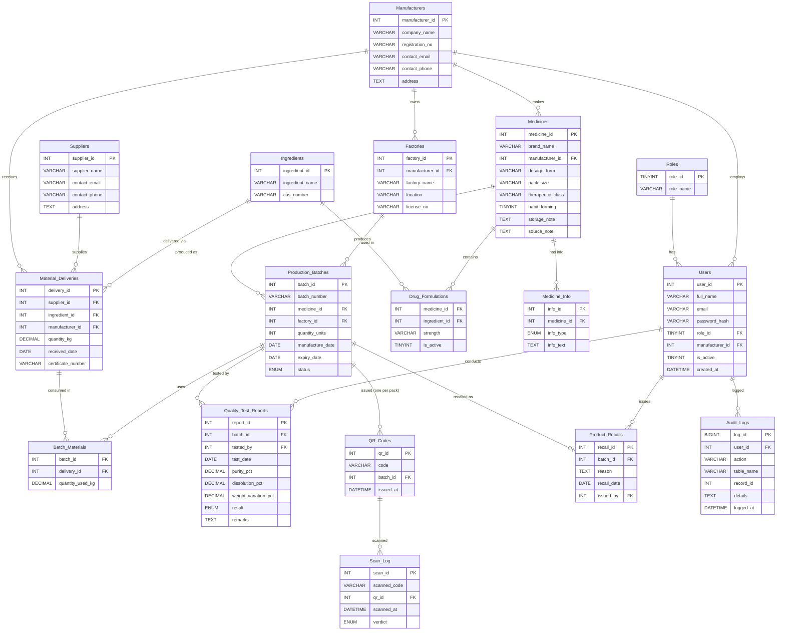

# PharmaTrace 360 — ER Diagram

> Generated for MySQL 8 schema (`db/01_schema.sql`).  
> All 17 tables are shown. Relationships use crow-foot notation.

---

## Mermaid Diagram

---

## Plain-English Relationship Guide

### 1-to-Many (one parent → many children)

| Relationship | Description |
|---|---|
| **Roles → Users** | One role (Admin/Regulator or Manufacturer) can be assigned to many users. |
| **Manufacturers → Users** | One manufacturer company can have many user accounts. Admin users have `manufacturer_id = NULL`. |
| **Manufacturers → Factories** | A manufacturing company can own and operate many factories. |
| **Manufacturers → Material_Deliveries** | A manufacturer receives many raw-material deliveries over time. |
| **Manufacturers → Medicines** | A manufacturer is responsible for many medicine products. |
| **Suppliers → Material_Deliveries** | One supplier makes many deliveries of ingredients. |
| **Ingredients → Material_Deliveries** | The same ingredient can arrive in many separate deliveries. |
| **Medicines → Medicine_Info** | A medicine has many info rows — one per use, side-effect, or drug interaction. |
| **Medicines → Production_Batches** | A medicine is manufactured in many batches over time. |
| **Factories → Production_Batches** | A factory produces many batches (of possibly different medicines). |
| **Production_Batches → Quality_Test_Reports** | A batch can be tested many times (re-tests allowed). |
| **Batch 1-to-many QR_Codes (one code per pack)** | Every approved batch yields many QR codes — one per physical pack/unit. Repeated scans of the same code are flagged as a possible counterfeit. |
| **QR_Codes → Scan_Log** | One QR code can be scanned many times by different members of the public. |
| **Users → Quality_Test_Reports** | One QA officer can conduct many tests. |
| **Users → Product_Recalls** | One admin can issue many recalls over time. |
| **Users → Audit_Logs** | Every action a user takes produces many log entries. |

---

### Many-to-Many (resolved via a junction table)

| Relationship | Junction Table | Extra Columns |
|---|---|---|
| **Medicines ↔ Ingredients** | `Drug_Formulations` | `strength` (e.g. 500 mg), `is_active` flag |
| **Production_Batches ↔ Material_Deliveries** | `Batch_Materials` | `quantity_used_kg` — how much of each delivery was consumed |

Both junction tables use **composite primary keys** (no surrogate ID), which is standard relational practice.

---

### 1-to-1 (enforced by UNIQUE constraint)

| Relationship | How enforced |
|---|---|
| **Production_Batches ↔ Product_Recalls** | `UNIQUE(batch_id)` on Product_Recalls — a batch can be recalled at most once. |

---

### Special Design Notes

- **`Scan_Log.scanned_code`** is a plain `VARCHAR`, **not** a foreign key.  
  This lets the system store scans of completely unknown or counterfeit codes without failing a FK constraint.  
  `qr_id` is a *nullable* FK — it is `NULL` when the scanned code matched nothing in QR_Codes.

- **`Audit_Logs.user_id`** is nullable to allow system-generated log entries (e.g. from triggers) where no human triggered the action.

- **`Medicine_Info`** and **`Drug_Formulations`** exist to eliminate repeating column groups from Medicines — a key normalization step explained in `docs/normalization.md`.
